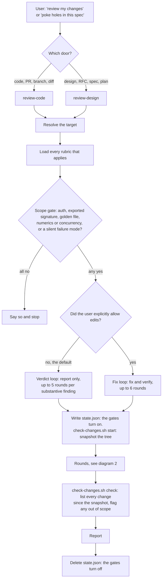
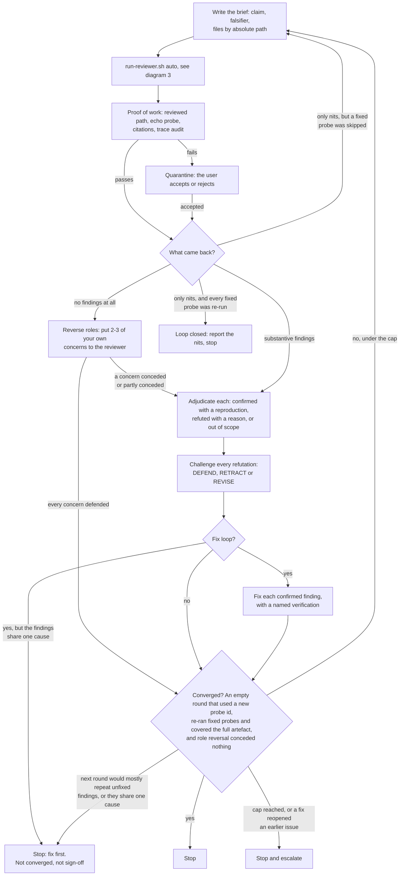
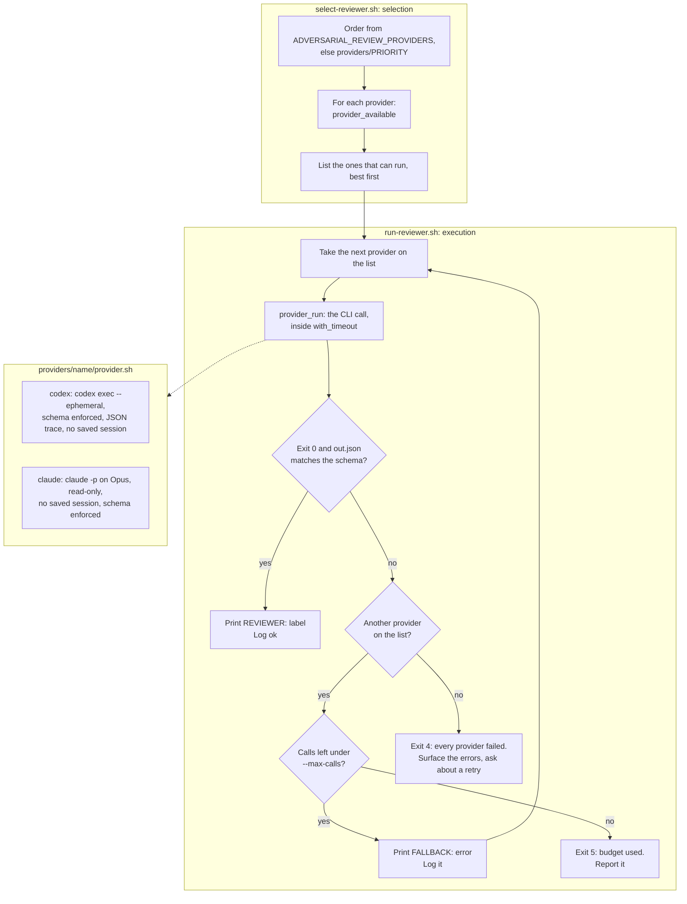
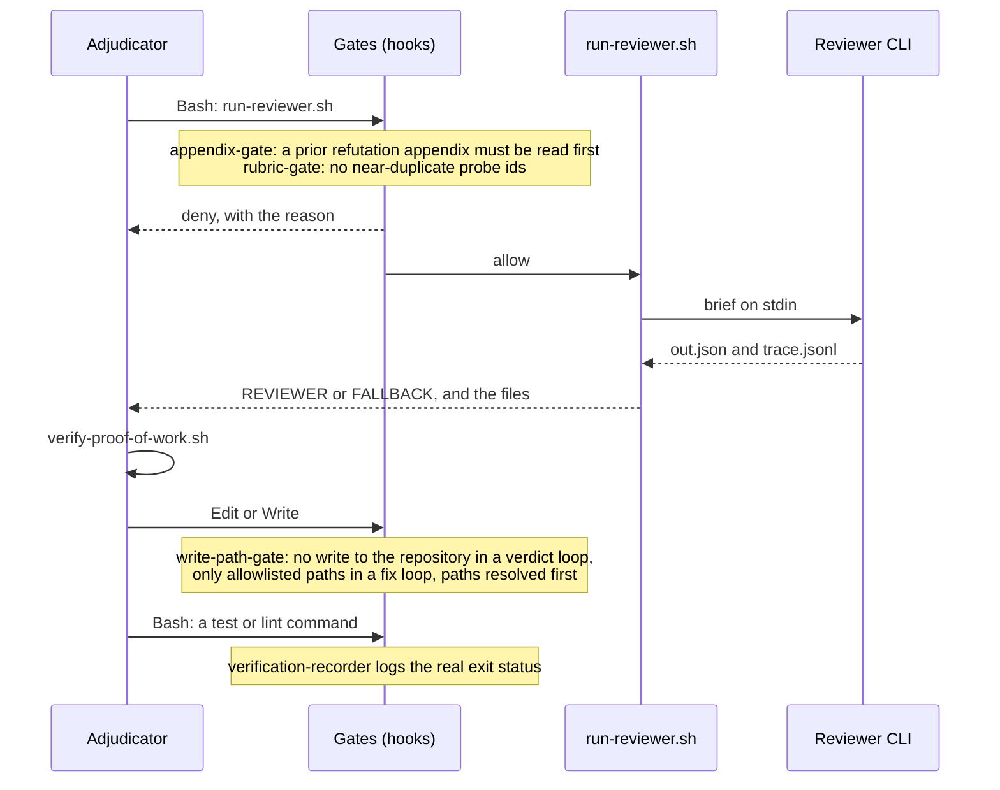

# How a review runs

Four views of the same process, from the outside in. The rules behind each step are in
[`engine/ENGINE.md`](engine/ENGINE.md) (the review loop) and
[`engine/invocation.md`](engine/invocation.md) (the reviewer call). These diagrams describe
those files; where the two disagree, the engine files win.

Three roles appear throughout:

- **The adjudicator** is the Claude session the user is talking to. It writes the briefs,
  judges every finding, makes any fixes, and writes the report.
- **The reviewer** is a separate process that reads the work blind and returns findings. It
  is a **provider**: Codex first, a separate Claude process as the fallback.
- **The gates** are hooks. They run outside the adjudicator's control and can refuse a call.

## 1. The review, end to end

The report states how many rounds ran and why they stopped (converged, nits only, fix first,
cap, thrash-escalated or budget), which reviewer ran each round
and any fallback, every substantive finding with its outcome, the nits, unverified
assumptions, proof-of-work results, and the standing limitations.

## 2. One round

**Substantive or nit** is decided from the finding's scenario, not its severity. A finding is
substantive when the scenario ends in a wrong outcome: a bug, an exposure, a broken contract,
or two readers of a spec building different things. Everything else is a nit. Nits never
start a round. In the fix loop a nit is fixed only when it sits in code already being changed
for a substantive finding.

**Fix first** stops a review that has found a larger issue, rather than spending rounds on
small adjustments around it. It is not a way past a real issue: every finding must already be
adjudicated and reported, and the report must say the review did not converge. The next step
is a fix, then a fresh review.

## 3. Choosing and running the reviewer

Selection and execution are separate, so a new provider is one directory and one line in
`PRIORITY`. See [`engine/providers/README.md`](engine/providers/README.md).

After a fallback the adjudicator passes the provider that succeeded for the remaining
rounds, so one reviewer covers the rest of the review, and records the switch in the report.

## 4. Where the gates fire

The gates keep a review on its scope; they guide rather than police. The Bash gates recognise
one form of reviewer call, `run-reviewer.sh`, which the skill sends every call through; a
reviewer CLI called directly, against the skill, is not detected. Keeping Claude reviewer
calls out of the session list is likewise done by the wrapper, which always passes
`--no-session-persistence`, not by a gate. Writes made through Bash are not predicted:
`check-changes.sh` catches them afterwards by comparing the working tree with the snapshot
taken when the review began.

The gates find `state.json` in the session's directory or the nearest directory above it, so
changing into a subdirectory mid-review does not switch them off.

Every gate **fails open**: with no `state.json`, or `active` not `true`, it allows the call.
A gate that blocks ordinary work gets disabled, and a disabled gate is worse than none.

## Files a review leaves

All under `.claude/adversarial-review/` in the repository:

| File | Written by | Holds |
|---|---|---|
| `state.json` | the adjudicator | whether a review is active, the loop, the write allowlist, the appendix path |
| `gate-log.tsv` | the gates | every time a gate fired, and what it decided |
| `reviewer-log.tsv` | `run-reviewer.sh` | every reviewer call, which provider ran, and every fallback |
| `verifications.jsonl` | `verification-recorder` | each verification command and its real exit status |
| `baseline-tree` | `check-changes.sh start` | the git tree of the working tree when the review began |
